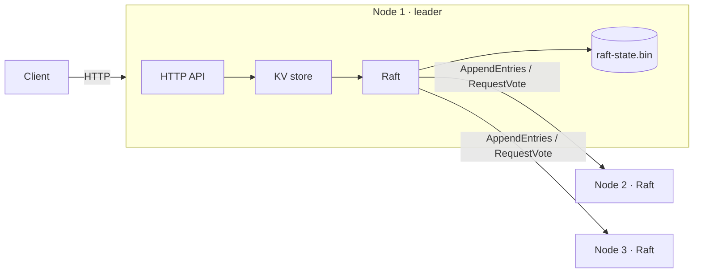

# raftkv

A fault-tolerant, linearizable key-value store built on a from-scratch implementation of the
[Raft consensus algorithm](https://raft.github.io/raft.pdf), written in Go using only the standard library.

A cluster of 3 nodes keeps working when any 1 node crashes or is cut off; a cluster of 5
survives 2. Every acknowledged write is durable and is never lost or reordered.

## Features

- **Leader election** with randomized timeouts, and the election restriction so only up-to-date nodes can win (§5.2, §5.4.1)
- **Log replication** with batching and fast conflict backtracking (one round trip per conflicting term, not per entry)
- **Durable state**: term, vote and log are fsynced and atomically replaced, so nodes recover after a crash
- **Group commit and batched replication**: one fsync and one RPC cover many client writes, for **18× higher throughput** than the naive design (see [Performance](#performance))
- **Linearizable reads and writes**: every operation goes through the log, and a leader commits a no-op on election so earlier-term entries commit safely (§5.4.2, §8)
- **Exactly-once writes**: optional client sessions (`X-Client-ID` + `X-Request-Seq`) deduplicate retries
- **Simple HTTP API**: followers redirect clients to the current leader
- **Test harness** that simulates partitions, crashes and restarts, and checks on every apply that no two nodes ever diverge

## Architecture



A write follows this path:

1. The client sends `PUT /kv/x` to any node. A follower replies `307` pointing at the leader.
2. The leader's KV store encodes the command and calls `raft.Start`, which appends it to the log and fsyncs.
3. The leader replicates the entry with `AppendEntries`. Once a majority have it on disk, it is **committed**.
4. Every node applies committed entries to its in-memory map in log order. The leader then replies to the client.

| Package | Responsibility |
|---|---|
| [`raft/`](raft/) | Consensus: elections, replication, commit, persistence, RPC transport |
| [`kv/`](kv/) | State machine, request/commit matching, deduplication, HTTP routes |
| [`cmd/kvnode`](cmd/kvnode/) | Runs one node |
| [`cmd/kvbench`](cmd/kvbench/) | Load generator reporting throughput and p50/p95/p99 latency |

## Getting started

Requires Go 1.22+.

```bash
go test ./... -race -count=1
```

`-race` needs a C compiler (cgo). On Windows without gcc, run `go test ./... -count=1`.

Start a 3-node cluster (Windows PowerShell):

```powershell
.\scripts\cluster.ps1
```

Or start the nodes by hand, one terminal each, on any OS:

```bash
go run ./cmd/kvnode -id 1 -cluster 1=127.0.0.1:8001,2=127.0.0.1:8002,3=127.0.0.1:8003
go run ./cmd/kvnode -id 2 -cluster 1=127.0.0.1:8001,2=127.0.0.1:8002,3=127.0.0.1:8003
go run ./cmd/kvnode -id 3 -cluster 1=127.0.0.1:8001,2=127.0.0.1:8002,3=127.0.0.1:8003
```

Use it (`-L` follows the redirect to the leader):

```bash
curl -L -X PUT --data "hello" http://127.0.0.1:8001/kv/greeting
curl -L http://127.0.0.1:8002/kv/greeting
curl -L -X DELETE http://127.0.0.1:8003/kv/greeting
curl http://127.0.0.1:8001/status
```

On Windows PowerShell, write `curl.exe` instead of `curl`.

### Try a failover

1. Find the leader with `/status`, then stop that process.
2. Within about 0.6 s the other two elect a new leader. Reads and writes keep working.
3. Restart the old node. It rejoins as a follower and catches up from the new leader.

### Benchmark

```bash
go run ./cmd/kvbench -addr 127.0.0.1:8001 -workers 32 -duration 10s
```

Point `-addr` at the leader to avoid paying a redirect on every request.
`.\scripts\bench.ps1` does this automatically: it starts a fresh cluster, finds the leader and runs the benchmark.

## Performance

3 nodes on one Windows laptop, a fresh cluster for each run, 10-second write benchmark (`scripts/bench.ps1`):

| Version | Clients | Throughput | p50 | p99 | Errors |
|---|---|---|---|---|---|
| Per-write fsync | 32 | 88 ops/s | 375 ms | 542 ms | 0 |
| **Group commit** | 32 | **554 ops/s** | **54 ms** | **115 ms** | 0 |
| Per-write fsync | 128 | 63 ops/s | 597 ms | 1371 ms | 799 timeouts |
| **Group commit** | 128 | **1580 ops/s** | **75 ms** | **188 ms** | 0 |

The first version fsynced once per write while holding the Raft lock, and started new
replication RPCs for every write. So 32 concurrent writes meant 32 sequential disk flushes on
the leader, and again on each follower. Two changes fixed this:

1. **Leader group commit.** `Start` appends to the in-memory log and signals a flusher goroutine.
   Each flush writes everything appended since the last one. While a flush is running, new
   writes queue up for the next. The leader counts itself toward a majority only for entries
   already flushed. It still sends entries to followers in parallel with its own disk write,
   which Raft allows (Ongaro's thesis §10.2.1).
2. **One replicator per follower.** Each follower has a single goroutine with one AppendEntries
   in flight. Entries appended while it waits are sent together in the next RPC, so followers
   also fsync once per batch.

Each save carries a version number, so a slow flush can never overwrite newer state on disk.
Term and vote changes, and follower appends, still fsync before replying, as Raft requires.

## Testing

`raft/cluster_test.go` runs whole clusters in memory, with a transport that can drop messages
between any pair of nodes. The tests cover:

| Test | Scenario |
|---|---|
| `TestInitialElection` | Exactly one leader is elected, and stays leader while the network is healthy |
| `TestReElection` | Leader partitioned → new leader; old leader rejoins and steps down; no leader without a majority |
| `TestBasicAgreement` | Commands commit on all nodes in order |
| `TestSingleNodeCommits` | A 1-node cluster commits through its own flush alone |
| `TestConcurrentStarts` | 100 simultaneous proposals each get a unique index and commit everywhere |
| `TestAgreementWithFollowerDown` | Progress with one follower down; it catches up on rejoin |
| `TestNoCommitWithoutMajority` | A leader cut off from 3 of 5 nodes cannot commit |
| `TestDivergentLeaderRejoins` | An isolated leader's uncommitted entries are overwritten |
| `TestPersistAcrossRestart` | Whole-cluster crash; committed entries survive and are re-applied |
| `TestLeaderCrashAndRestart` | Leader crash, failover, and recovery |

On every apply, the harness asserts that no two nodes hold different commands at the same index,
which is the key safety property of Raft.

## Design decisions

- **Reads go through the log.** This is the simplest correct way to get linearizable reads. A deposed leader that doesn't know it lost leadership can't serve stale data. The cost is a replication round trip per read (see the roadmap).
- **One port per node.** Raft RPCs (`net/rpc` over HTTP `CONNECT`) and the client API share a listener, so cluster config is just `id=host:port`.
- **Whole-state persistence.** Each flush rewrites the state file via write-then-rename. This is simple and crash-safe, and group commit amortises the cost over many writes. But each flush is still O(log size), so throughput drops as the log grows. An append-only WAL plus snapshots is the fix.
- **Persistence failures panic.** Continuing after a failed fsync could let a node forget a vote or entry and break safety.

## Roadmap

- [ ] Log compaction with snapshots and `InstallSnapshot` (§7)
- [ ] Append-only segmented WAL instead of rewriting the full state
- [ ] ReadIndex or lease-based reads that skip the log (§8)
- [ ] Cluster membership changes (joint consensus, §6)
- [ ] Sharding with multiple Raft groups
- [ ] Prometheus metrics and a Docker Compose demo with fault injection

## References

- Diego Ongaro and John Ousterhout, *In Search of an Understandable Consensus Algorithm (Extended Version)*, 2014
- MIT 6.5840 Distributed Systems, Labs 3–4
- [etcd/raft](https://github.com/etcd-io/raft), a production Raft library
