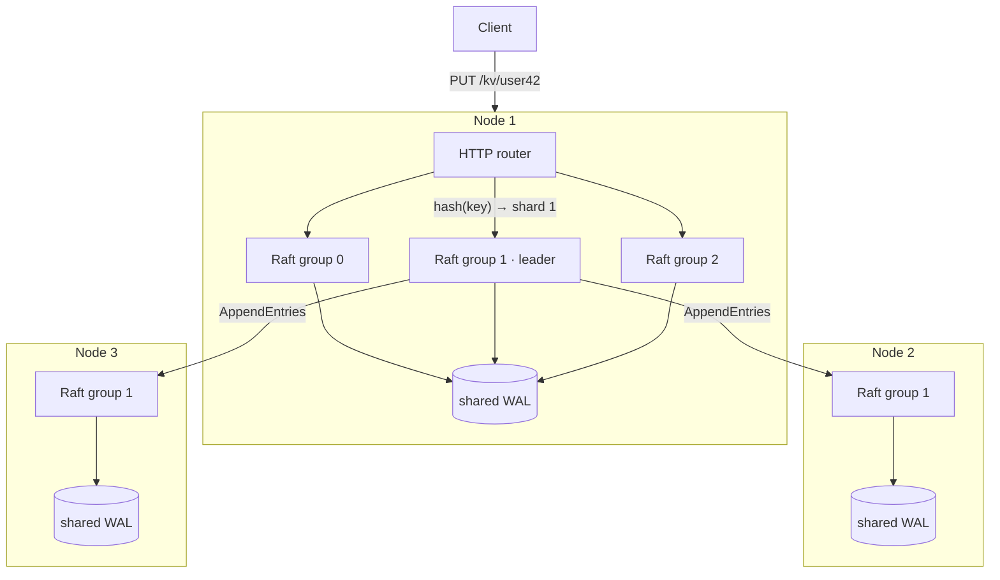

# raftkv

[](https://github.com/Prathamesh250205/raftkv/actions/workflows/ci.yml)

A sharded, fault-tolerant, **linearizable** key-value store built on a from-scratch implementation
of the [Raft consensus algorithm](https://raft.github.io/raft.pdf) in Go. The servers use only the
standard library.

Keys are hashed across independent Raft groups (Multi-Raft, as in TiKV and CockroachDB). Each
group keeps working while a minority of its replicas are down, and every acknowledged write
survives crashes. Correctness is checked by a randomized chaos test with the
[Porcupine](https://github.com/anishathalye/porcupine) linearizability checker.

| | |
|---|---|
| Write throughput | **5,757 ops/s** on a 3-node cluster, 91× the first version |
| Read throughput | **12,359 ops/s** with ReadIndex, 19× faster than reading through the log |
| Leader failover | **0.5 s** |
| Verified | linearizable under random partitions, crashes, restarts, 2% message loss and snapshots |

## Features

**Raft core** ([`raft/`](raft/))
- Leader election, log replication with fast conflict backtracking, durable state (§5)
- **Log compaction** with snapshots and `InstallSnapshot` for far-behind followers (§7)
- **Linearizable reads with ReadIndex**: one heartbeat round, no disk write (§8)
- **Membership changes** one server at a time, including a leader removing itself (thesis §4)
- **Disruptive-server protection**: removed nodes cannot depose the leader (thesis §4.2.3)
- **Leadership transfer** with `TimeoutNow` (thesis §3.10)
- **Group commit and batched replication**: one fsync and one RPC cover many writes

**Storage and sharding**
- **Multi-Raft**: keys hashed across N Raft groups, each with its own log, leader and membership
- **Shared write-ahead log**: all of a node's groups share one append-only, CRC-checked file and one fsync
- **Shard rebalancing**: move a shard between nodes with `kvctl move-shard`
- **Leader balancing**: leadership is spread evenly across nodes automatically

**Operations**
- HTTP API; any node redirects you to the right shard leader
- **Exactly-once writes** with client sessions (`X-Client-ID` + `X-Request-Seq`)
- Prometheus `/metrics` and a provisioned **Grafana dashboard**
- `kvctl` admin CLI, `kvbench` load generator, a Docker Compose cluster and a **chaos script**
- CI on Linux (race detector) and Windows

## Architecture



A write goes like this:

1. A client sends `PUT /kv/user42` to any node. The node hashes the key (FNV-1a) to a shard. If
   it isn't that shard's leader, it replies `307` with the leader's address.
2. The shard leader appends the command to its in-memory log and wakes two background loops:
   - the **flusher**, which writes everything appended so far to the shared WAL with one fsync;
   - the **replicators**, one per follower, each keeping one `AppendEntries` in flight and
     batching whatever arrived meanwhile.
3. Once a majority has the entry on disk, it is **committed**. The leader counts itself only after
   its own flush. Every replica then applies the entry to its state machine.
4. The leader replies. A retried write with the same session ID and sequence number is applied
   at most once.

A read skips the log entirely. The leader records its commit index, confirms it is still leader
with one round of heartbeat acknowledgements from a majority, waits until that index is applied,
and answers from memory.

| Package | Responsibility |
|---|---|
| [`raft/`](raft/) | Consensus, snapshots, membership, leadership transfer, ReadIndex, persisters, RPC transport, in-memory test network |
| [`kv/`](kv/) | Replicated state machine: commands, sessions, snapshots, key hashing |
| [`server/`](server/) | One node: a Raft group per shard, HTTP API, routing, leader balancing |
| [`metrics/`](metrics/) | Dependency-free Prometheus exporter |
| [`cmd/kvnode`](cmd/kvnode/) | Runs a node |
| [`cmd/kvctl`](cmd/kvctl/) | Admin CLI: status, add/remove nodes, move shards |
| [`cmd/kvbench`](cmd/kvbench/) | Load generator with shard-aware routing |

## Quick start

Requires Go 1.22 or newer.

```bash
go test ./...
```

### One click: GitHub Codespaces (free, nothing to install)

[](https://codespaces.new/Prathamesh250205/raftkv)

In the codespace terminal, run `./scripts/codespace-demo.sh`. It starts 3 nodes × 3 shards plus
Prometheus and Grafana, and prints the API token and links. To share it, make ports **8001** (API)
and **3000** (dashboard) public in the **Ports** tab. Reads and the dashboard are then open to
anyone; writes still need the token.

### Docker: cluster, dashboard and chaos

```bash
docker compose up -d --build     # 3 nodes x 3 shards, Prometheus, Grafana
./scripts/chaos.sh               # writes for 60 s while nodes are frozen, crashed and partitioned
```

Open **http://localhost:3000** to watch leaders move, terms step up and latency recover in real time.

### Windows, without Docker

**Guided demo:** `.\scripts\demo.ps1` starts a cluster, writes data, kills a shard leader, shows
the failover and that nothing was lost, restarts the node and benchmarks it, pausing before each
step. Add `-Auto` to run it straight through.

```powershell
.\scripts\cluster.ps1 -Shards 3      # builds and starts 3 nodes on ports 8001-8003
.\bin\kvctl.exe status
.\scripts\cluster.ps1 -Stop
```

Use `curl.exe` instead of `curl` in PowerShell. `-L` follows the redirect to the shard leader:

```bash
curl -L -X PUT --data "hello" http://127.0.0.1:8001/kv/greeting
curl -L http://127.0.0.1:8002/kv/greeting
curl -L -X POST --data " world" http://127.0.0.1:8003/kv/greeting/append
curl -L -X DELETE http://127.0.0.1:8001/kv/greeting
curl http://127.0.0.1:8001/status
curl http://127.0.0.1:8001/metrics
```

### Growing the cluster and moving shards

```bash
kvnode -id 4 -addr 127.0.0.1:8004 -shards 3 -join      # starts empty
kvctl -addr 127.0.0.1:8001 add-node 4 127.0.0.1:8004    # joins every shard; catches up via snapshot
kvctl -addr 127.0.0.1:8001 move-shard 2 1 4 127.0.0.1:8004   # shard 2: node 1 -> node 4
kvctl -addr 127.0.0.1:8001 remove-node 1
```

```
SHARD  LEADER   MEMBERS
0      1        1=127.0.0.1:8001 2=127.0.0.1:8002 3=127.0.0.1:8003
1      2        1=127.0.0.1:8001 2=127.0.0.1:8002 3=127.0.0.1:8003
2      4        2=127.0.0.1:8002 3=127.0.0.1:8003 4=127.0.0.1:8004
```

## API

| Method and path | |
|---|---|
| `GET /kv/{key}` | Linearizable read (404 if missing) |
| `PUT /kv/{key}` | Write the body as the value |
| `POST /kv/{key}/append` | Append the body to the value |
| `DELETE /kv/{key}` | Remove a key |
| `GET /status` | This node's Raft state for every shard |
| `GET /shards` | Leader and members of every shard (asks other nodes if needed) |
| `GET/POST /shards/{g}/members`, `DELETE /shards/{g}/members/{id}` | Shard membership |
| `GET /metrics` | Prometheus metrics |

Requests that reach the wrong node get `307` plus an `X-Raft-Leader` header, or are relayed to
the leader when nodes run with `-forward`. `503` with `Retry-After` means "no leader right now,
retry".

## Security and deployment

| Flag | Effect |
|---|---|
| `-auth-token` (or `$RAFTKV_AUTH_TOKEN`) | Writes and membership changes need it in the `X-Api-Token` header |
| `-public-reads` | With a token, reads stay open to anyone |
| `-cluster-secret` (or `$RAFTKV_CLUSTER_SECRET`) | Peers must present it to open Raft RPC connections |
| `-forward` | Relay requests to the shard leader instead of redirecting; for nodes on private IPs |

Tokens are compared in constant time. A custom header is used instead of `Authorization`,
because HTTP clients drop `Authorization` when a redirect goes to another host.

**[docs/DEPLOY.md](docs/DEPLOY.md)** walks through running the cluster on three Oracle Cloud
free-tier VMs. Caddy provides HTTPS with automatic certificates, Raft stays on the private
network, and Grafana is public but read-only. Setup is one command per VM
([`deploy/cloud/setup.sh`](deploy/cloud/setup.sh)).

## Testing

41 tests across four packages. Raft tests run whole clusters over an in-memory network that can
drop, delay and partition messages, crash nodes and restart them from their saved state. On every
applied entry, the harness asserts that **no two nodes ever apply different commands at the same
index**.

| Area | What is tested |
|---|---|
| Elections | One leader per term; re-election after a partition; no leader without a majority |
| Replication | Agreement; follower catch-up; no commit without a majority; a deposed leader's uncommitted entries get overwritten; 100 concurrent proposals |
| Persistence | Whole-cluster crash and restart; leader crash and recovery |
| Snapshots | Log stays bounded; lagging follower catches up through `InstallSnapshot`; restart; snapshots under repeated partitions |
| ReadIndex | Healthy leader; **an isolated leader refuses reads** (no stale data); new leader after commit |
| Membership | Add; remove a follower; **removed nodes can't disrupt** (without the guard the term climbs from 1 to 11); leader removes itself; one change at a time; restart; **rolling replacement of every founding node** |
| Leadership transfer | Hand-off; refusal when the target is behind |
| Shared WAL | Round trip; **torn-tail recovery**; compaction; concurrent batching |
| Sharded cluster (real HTTP) | End-to-end routing; leader balancing; failover and restart from disk; moving a shard to a new node, which then routes requests for shards it doesn't host |
| Security | Token required for writes and membership; private reads; **RPCs without the cluster secret are refused**; forward mode answers without redirects |
| **Linearizability** | 5 nodes, 6 clients, 8 s of gets/puts/appends while a nemesis partitions, crashes and restarts nodes with 2% packet loss. The history (2,500–6,000 ops per run) is checked with Porcupine |

The linearizability test has already caught one real bug: a concurrent map access when starting
replicators, which crashed about once in 45 runs
([fix](https://github.com/Prathamesh250205/raftkv/commit/c083f2c)).

## Performance

All numbers come from 3 nodes on **one Windows laptop**. Each run starts a fresh cluster and lasts
10 seconds (`scripts/bench.ps1`), with 128 clients unless noted.

### Writes: from 63 to 5,757 ops/s

| Version | Throughput | p50 | p99 |
|---|---|---|---|
| fsync on every write, holding the Raft lock | 63 ops/s (799 timeouts) | 597 ms | 1,371 ms |
| + group commit and batched replication | 1,790 ops/s | 67 ms | 140 ms |
| + shared write-ahead log | **5,757 ops/s** | **18 ms** | 86 ms |

- **Group commit**: the leader appends in memory, and a flusher goroutine makes everything
  appended since the last flush durable in one write. Each follower has one replicator with one
  RPC in flight, so entries batch up while it waits. The leader counts itself toward a majority
  only after its own flush (Ongaro's thesis §10.2.1). A version number on each save keeps a slow
  flush from overwriting newer state.
- **Shared WAL**: appending to one open file avoids creating, fsyncing and renaming a temp file on
  every save, which is slow on Windows.

### Reads: 19× with ReadIndex (32 clients)

| Reads | Throughput | p50 |
|---|---|---|
| Through the Raft log (`-log-reads`) | 642 ops/s | 48 ms |
| **ReadIndex** | **12,359 ops/s** | **2.3 ms** |

### Sharding on one machine

| Shards | Separate files per shard | Shared WAL |
|---|---|---|
| 1 | 1,790 ops/s | 5,757 ops/s |
| 3 | 809 ops/s | 4,767 ops/s |
| 6 | 423 ops/s (96 errors) | 3,612 ops/s |

With a file per shard, throughput fell as **1/shards**. The metrics showed why. The disk's flush
rate was fixed (about 100 flushes/s across the cluster) and the shards split it between them:
average fsync time rose from 21 ms to 147 ms, and batches shrank from 66 to 14 entries. Sharing
one log per node, so one fsync covers every shard, made 6 shards **8.5× faster**.

Even so, more shards do **not** beat one shard *on this laptop*. All three "nodes" share one disk
and one CPU, so there is nothing to spread the work across. Sharding pays off when shards lead on
different machines with their own disks, and it adds capacity and fault isolation: a node only
stores the shards it replicates (`-replicas`), and a shard moves with `kvctl move-shard`. Those
multi-machine gains weren't measured here.

## Design decisions

- **Reads use ReadIndex, not leases.** Leases avoid even the heartbeat round, but they depend on
  bounded clock drift. ReadIndex is safe no matter what the clocks do.
- **Single-server membership changes.** Simpler than joint consensus, and safe because any two
  majorities of configurations that differ by one node overlap. A leader must commit an entry of
  its own term before changing membership, which avoids the bug described in the thesis errata.
- **Whole-state records in the WAL.** Each save is the group's full state (bounded by compaction),
  so recovery only needs the latest record per group. A per-entry WAL would write less per save.
  Batching made that unnecessary so far.
- **One port per node.** Client API, admin API, metrics and every shard's Raft RPCs
  (`/_raft/rpc/{shard}`) share one listener.
- **Persistence failures are fatal.** Continuing after a failed fsync could make a node forget a
  vote or an entry, which breaks safety.

## Limitations and next steps

- [ ] **PreVote** (thesis §9.6): a node that rejoins after a partition still bumps the term once and
      causes one extra election.
- [ ] **Learners**: a new member counts toward the majority immediately, even while it is still
      catching up.
- [ ] **Shard splitting**: the shard count is fixed when the cluster is created; shards can move
      between nodes but not split.
- [ ] Per-entry WAL records, and a client library with a cached shard map.
- [ ] A benchmark on multiple machines (the deployment guide sets this up).
- [ ] TLS for Raft RPCs. Today they rely on a private network plus the cluster secret.

## References

- Diego Ongaro and John Ousterhout, *In Search of an Understandable Consensus Algorithm (Extended Version)*, 2014
- Diego Ongaro, *Consensus: Bridging Theory and Practice* (PhD thesis), Stanford, 2014
- MIT 6.5840 Distributed Systems, Labs 3–5
- [etcd/raft](https://github.com/etcd-io/raft), [TiKV](https://github.com/tikv/tikv), [Porcupine](https://github.com/anishathalye/porcupine)
